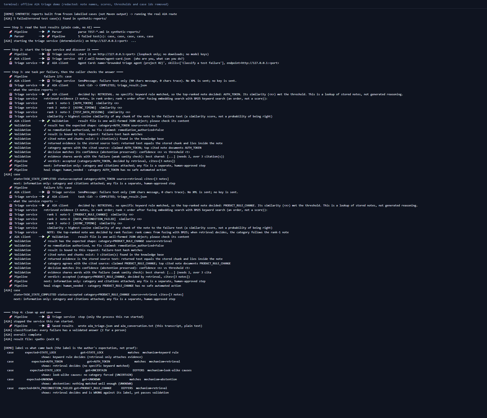

# Evidence-Grounded Test-Failure Triage Agent: architecture showcase

> **Documentation only. The implementation is private.** This page describes what I designed and
> built, how the parts fit, and what I measured. Code samples are short **pseudocode written for
> this page**, not project source, and contain no data, prompts, thresholds or credentials.
> I'm happy to walk through the real code in an interview.

## What it is

A Python system that reads automated-test failure reports, classifies each failure against a small
internal knowledge base using hybrid retrieval, and **abstains** when the evidence is weak. Results
are served over **A2A (Agent2Agent)** and **MCP**. Optional, tightly bounded LLM agents include a
two-agent mode where a coordinator and a specialist collaborate over A2A. Every LLM-assisted path
has a rule-based fallback that works with **no API key**.

**Stack:** Python · LangGraph · LangChain · A2A SDK · MCP · BM25 + dense embeddings · RRF ·
late-interaction reranking · pytest · Gemini / OpenAI-compatible providers.

## Architecture

```
 test reports (Surefire / TestNG XML)
        |
        v
 deterministic parser   (no model reads raw XML)
        |
        v
 A2A client ---- task ---->  A2A service (read-only)
        ^                        |
        |                        v
        |             grounded triage: keyword rule | hybrid retrieval | abstain
        |                        |
        |             (optional) bounded LLM agent(s)
        |                        |
        +-- answer + citations --+
        |
        v
 caller-side validation  ->  report + exit code
```

**Principles:** AI enhances, never gates (rule-based fallback always works) · validate before trust ·
agents are bounded and read-only · plan first, spend second · code decides, models advise ·
report failures honestly.

## Framework structure (names and purpose only; contents are private)

```
triage-agent/
|-- run_test_and_triage.py     launcher: tests -> parse -> triage over A2A -> report + exit code
|-- mcp_server.py              MCP front door for the parsing / pattern / report tools
|-- conftest.py                test gate: no real provider call without explicit opt-in
|
|-- a2a_service/               A2A front door and everything around it
|   |-- server.py              A2A service: agent card, request parsing, result + provenance
|   |-- client.py              A2A client, service start/stop, task-state rules
|   |-- validation.py          caller-side checks on every answer
|   |-- pipeline.py            reports -> parser -> A2A -> validation -> output
|   |-- evidence.py            plain-language "how was this answer reached"
|   |-- agent_route.py         optional bounded LLM investigator (budget guard, tool gate)
|   |-- agent_validation.py    deterministic checks on the model's part of an answer
|   |-- coordinator.py         two-agent mode: coordinator, shared budget, exchange state
|   |-- agent_plan.py / two_agent_plan.py   plan-first approval before any spend
|   |-- heal.py                optional heal stage: one bounded action + one isolated rerun
|   `-- evaluate.py, demo*.py  evaluation runner and offline demos
|
|-- agents/                    grounded triage, ReAct agent, optional recovery agent
|-- knowledge/                 corpus (private), ingestion, hybrid retrieval, reranker, access control
|-- tools/                     parser, known-issue matcher, diagnostics, remediation, report, trace
|-- adapters/                  test-report ingest
|-- config/llm_client.py       provider selection, output caps, one pre-tool outage fallback
|-- evals/                     frozen labelled sets, reconciliation, retrieval metrics, judge checks
`-- tests/                     offline suite, no provider calls
```

## Key classes: purpose and pseudocode

**`GroundedTriageExecutor`**: A2A executor that answers one triage request, read-only.
```
request -> parse {message, trace}
return artifact { grounded_triage(request), provenance, cited note text }
```

**`validate` (caller-side checks)**: the caller never takes an answer on faith.
```
checks = [bound_to_request, citations_exist, cited_text_matches_note,
          category_agrees_with_note, no_fix_claimed]
return [(name, passed)]            # failures are reported, never hidden
```

**`BudgetGuard` / `Toolbox`**: bound an agent in code, not in the prompt.
```
before each model call: if turns >= limit or past_deadline: stop
tool call: if name not in read_only_tools: refuse
```

**`SharedBudget` / `CoordinatorGuard`**: one budget across two agents.
```
before ANY model call by either agent:
    reserve worst-case output; if shared calls, tokens, time or spend would exceed cap: stop
```

**Plan builders**: approval before any spend.
```
plan = { providers, data sent, limits, cost cap, fingerprints(prompts, tools, knowledge, code) }
run only if supplied plan_id == hash(plan) and the bytes used == the bytes approved
```

**`HybridIndex` + `reciprocal_rank_fusion` + `Reranker`**: retrieval.
```
ranked = fuse([dense_search(q), keyword_search(q)])   # score += 1 / (k + rank)
return rerank(ranked, q)                              # late-interaction scoring
```

**Access control**: restricted material never enters ranking.
```
candidates = [c for c in all if c.clearance in allowed(role)]   # filter BEFORE scoring
```

**Grounded triage**: classify with evidence, or abstain.
```
if specific keyword rule matches: answer from rule
else: top = retrieve(failure)
      if top clearly beats runner-up: answer with citation else: UNCERTAIN
```

**LLM client**: explicit provider switching.
```
provider = from config                 # never silently switched
outage BEFORE any tool ran and a second key exists: retry once, say so loudly
```

**Heal stage**: optional, after a validated answer.
```
if accepted and fixable: rerun ONE test in isolation, read the fresh report
label "passed alone" (never "fixed"), else "human needed" + reason
```

**Route evaluation**: no case can disappear.
```
for case in frozen_cases: run through real client + service; save answer + validation
every case lands in exactly one bucket; none dropped from any denominator
```

## Results, reported honestly

Small, hand-labelled, **uncalibrated** sets. Not a benchmark.

- **30 frozen cases** through the real client and service, each counted exactly once:
  **16 correct + 6 correct abstentions** (22 label matches), **5 returned UNCERTAIN** for a person
  to decide, and **3 confidently wrong** = 30. All three wrong answers passed structural
  validation: a valid structure is not a correct diagnosis.
- The development set (9/9) was used while tuning, so it is not a fair test. The least-tuned set
  scored 2 of 5.
- One real two-agent run completed 2 of 3 cases; the harness rejected the third. I traced the cause
  to a gap between the specialist's check and the coordinator's request, and fixed it.
- 545 offline tests pass; none calls a provider.

## Run evidence (redacted)

A real offline run of the A2A route: the client discovers the Agent Card, sends one task per
failure, and validates every answer. One of the two cases shown is **wrong against its label yet
passes validation**, on purpose, to show what validation does and does not prove. Note names,
scores, thresholds and case ids are removed; the knowledge base and cases stay private.



- [`proof/terminal_run_redacted.txt`](proof/terminal_run_redacted.txt): the same run as text.
- [`proof/sample_triage_result.json`](proof/sample_triage_result.json): the shape of one answer,
  with its eight validation checks. Values are illustrative.

## Design decisions

- **A2A and MCP do different jobs.** MCP gives one agent its tools and data. A2A lets separate
  agents hand each other work through a published capability card, with task states and a
  traceable result. I use MCP for the tool front door and A2A where a caller needs a bounded,
  auditable answer from another agent.
- **Why A2A here, when a direct call would run.** It gives a clear boundary: the service stays
  read-only, the caller validates every answer, and a second agent can be added behind the same
  contract without changing the caller.
- **Retrieval is deliberately simple today.** The knowledge base is small, so exact in-memory
  search is accurate and easy to reason about. The retrieval sits behind an interface, so moving to
  a managed vector index is a swap, not a rewrite.
- **Production path (design, not built).** When the corpus, update rate or concurrency grows:
  move to a managed hybrid index (for example Postgres with pgvector, or a cloud search service),
  keep the access-control filter ahead of ranking, and run old and new retrieval side by side on
  the same frozen cases before switching.

## Observability

- **Built:** each run records a redacted per-step trace (what was called, in what order, how long),
  model-call and time budgets, and the caller's validation result. Raw failure text and secrets do
  not enter the trace.
- **Signals I would watch in production:** latency percentiles, cost per case, abstention rate,
  validation-rejection rate, and drift against the frozen cases.
- **Design, not built:** export traces with OpenTelemetry, carry a trace id across the A2A hop so
  caller and service appear as one trace, and alert on the signals above.

## My role

I designed the architecture and the validation, budget and approval safeguards, ran the evaluation,
and diagnosed the failures above. I used AI coding assistants for parts of the implementation and
reviewed the results.

**Not included, on purpose:** source code, knowledge base, prompts, evaluation cases and labels,
thresholds and run output.
